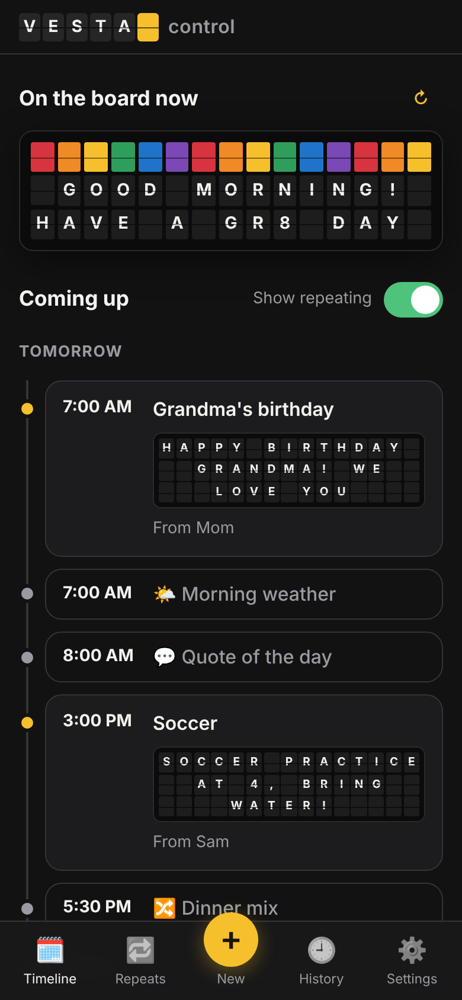
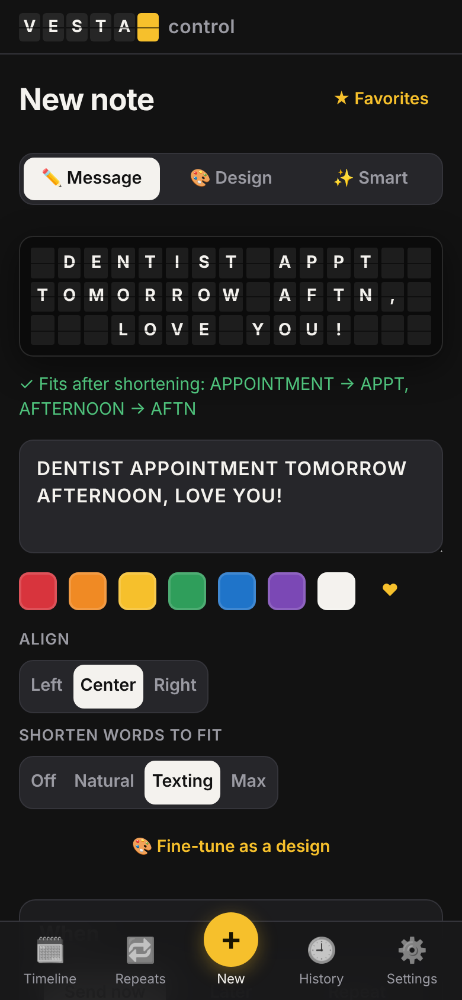
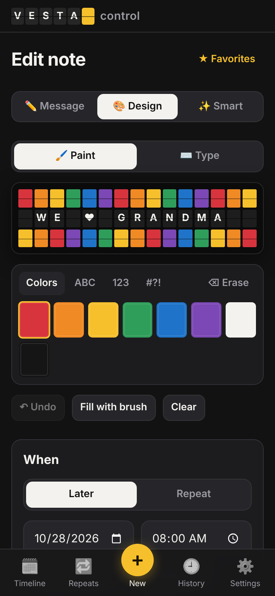
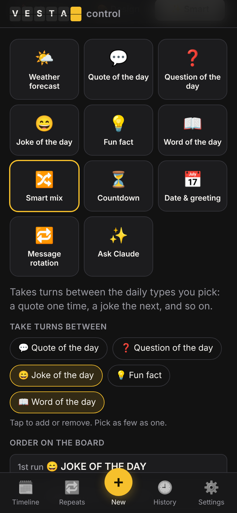
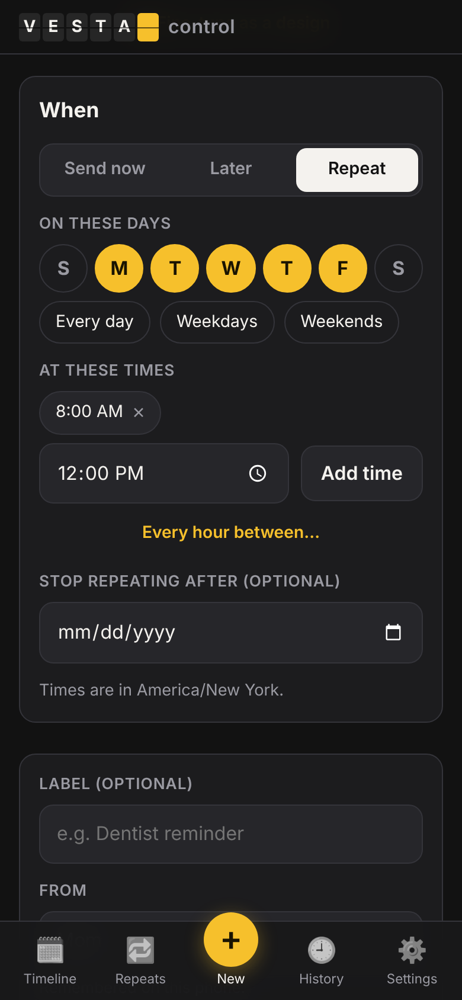
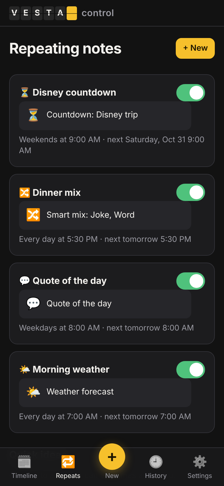

# Vestacontrol

A mobile web app for scheduling notes, designs and daily surprises on your **Vestaboard Note** or **Vestaboard Flagship**, built for the whole household. There are no user accounts: everyone shares one household password.

To set up your own copy, follow [Deploy](#deploy-one-time-setup-about-10-minutes) below.

## Screenshots

<table>
  <tr>
    <td align="center" width="33%"><br><b>Timeline</b><br><sub>What's on the board now, and everything coming up</sub></td>
    <td align="center" width="33%"><br><b>Write a message</b><br><sub>Live preview, with words shortened only when needed</sub></td>
    <td align="center" width="33%"><br><b>Design</b><br><sub>Paint tiles with any color, letter or symbol</sub></td>
  </tr>
  <tr>
    <td align="center"><br><b>Smart notes</b><br><sub>Weather, quotes, jokes, word of the day, Smart mix and more</sub></td>
    <td align="center"><br><b>Schedule</b><br><sub>Send now, later, or on a repeating schedule</sub></td>
    <td align="center"><br><b>Repeating notes</b><br><sub>Pause, edit or add with one tap</sub></td>
  </tr>
</table>

<sub>Screenshots use made-up demo data on a Vestaboard Note.</sub>

## Features

- **Timeline** of everything coming up, plus a live view of what's on the board right now
- **Message composer** with a live board preview. It uppercases, word-wraps and centers your text, and **automatically shortens words** (TOMORROW → TMRW, BIRTHDAY → BDAY, AND → &) only when the message wouldn't otherwise fit. You choose how aggressive it gets: Off / Natural / Texting / Max.
- **Design editor**: paint tiles with any Vestaboard color, letter or symbol, or switch to *Type* mode and type straight onto the grid. Includes undo, fill and clear. Color emoji like 🟥 💙 work in messages too.
- **Scheduling**: send now, at a specific time, or repeating (pick days, several times a day, "every hour between…", and an optional end date)
- **Smart notes** that are generated fresh each time they're sent:
  - 🌤️ Weather forecast (free [Open-Meteo](https://open-meteo.com), no key needed)
  - 💬 Quote of the day, ❓ question of the day, 😄 joke, 💡 fun fact, 📖 word of the day
  - 🔀 Smart mix: takes turns between any of those five that you pick, such as a joke one day and a word the next
  - ⏳ Countdown ("12 DAYS UNTIL DISNEY TRIP"), with yearly repeat for birthdays and holidays
  - 📅 Good morning + date
  - 🔁 Message rotation (cycles through your own list)
  - ✨ Ask Claude (optional): write any prompt and Claude writes content sized to fit your board
- **Edit, pause or delete** any note; one-tap **quick ideas** for common repeating notes
- **Quiet hours**: repeating notes won't flip the board overnight
- **Protect a message from repeating notes** (for one-time and "send now" messages): so a birthday message isn't replaced 10 minutes later by the hourly weather. Repeating notes that come up meanwhile are skipped, not delayed, and **Release** on the Timeline ends the protection early.
- **Favorites** for reusing designs and messages
- **History** of everything sent (or failed or skipped), with "send again"
- **"From"** name on notes, so everyone knows who left the message
- Installable on your phone's home screen (PWA)

## How it works

```
Phone browser ──▶ Cloudflare Worker (API + static React app)
                        │   ▲
                        ▼   │ cron: every minute
                   Cloudflare D1 (SQLite) ──▶ Vestaboard cloud API
```

- **Frontend**: React + Vite (`src/client`)
- **Backend**: a Cloudflare Worker using Hono (`src/worker`). A cron trigger runs every minute, sends any note that's due, and advances repeating schedules.
- **Shared logic** (`src/shared`) such as the text formatter, abbreviations, character codes and timezone-aware scheduling runs in both the browser (live preview) and the Worker.
- **Database**: Cloudflare D1. Schema lives in `migrations/`.

**Why Cloudflare?** For one household it's **free**. The Workers free tier includes cron triggers that run every minute (which this app needs for on-time scheduling), and D1 includes a free SQLite database. Vercel's free plan only runs cron jobs once a day, and DigitalOcean starts at about $5/month.

## Deploy (one-time setup, about 10 minutes)

Once this is set up, every push to `main` deploys automatically through GitHub Actions.

1. **Create a free Cloudflare account** at [dash.cloudflare.com](https://dash.cloudflare.com/sign-up). You don't need a domain or a credit card.
2. **Pick your `workers.dev` subdomain**: click **Workers & Pages** in the sidebar once. A new account is asked to choose a free subdomain (for example `yourname.workers.dev`). The app will live at `vestacontrol.<subdomain>.workers.dev`. You don't need to create a Worker yourself; the deploy does that.
3. **Create an API token**: go to [*My Profile → API Tokens*](https://dash.cloudflare.com/profile/api-tokens) → **Create Token**, then click **Use template** next to **Edit Cloudflare Workers**.
   - Under *Permissions*, click **+ Add more** and add **Account → D1 → Edit**. The template doesn't include it, and the deploy needs it to create the database.
   - Set *Account Resources* to your account and *Zone Resources* to **All zones**.
   - Create the token and **copy it right away**. Cloudflare only shows it once.
4. **Find your Account ID**: it's shown in the right sidebar of the **Workers & Pages** overview page.
5. **Add GitHub secrets**: in this repo, go to *Settings → Secrets and variables → Actions → New repository secret* and add:
   - `CLOUDFLARE_API_TOKEN`
   - `CLOUDFLARE_ACCOUNT_ID`
   - `ANTHROPIC_API_KEY` *(optional; see [Claude features](#claude-features-optional))*
6. **Push to `main`** (or merge a PR). The workflow creates the database, applies migrations and deploys. To find your app's address, open the Cloudflare dashboard and go to **Workers & Pages → vestacontrol**. The deploy log hides it, since this repo may be public.
7. **Open it on your phone right away.** The setup wizard walks you through creating the household password, choosing your board, connecting the Vestaboard API, and setting your time zone and location.

> **Whoever opens the site first sets the household password**, so do it as soon as the first deploy finishes.

**Added or changed a secret after merging?** Secrets only take effect on the next deploy. Go to **Actions → CI & Deploy → Run workflow** (on `main`) to redeploy without changing any code. If a secret is missing, the deploy step is skipped with a warning rather than failing.

**Deploy failed with a permissions error?** The API token is usually missing **D1 → Edit**. Edit the token in Cloudflare, then re-run the workflow.

**Custom domain (optional):** in the Cloudflare dashboard, open *Workers & Pages → vestacontrol → Settings → Domains & Routes*.

### Getting your Vestaboard API key

Use either option. Both work for the Note and the Flagship.

- **Read/Write API key** (simplest): in the Vestaboard app, go to *Settings → Developer → Read / Write API*, enable it and copy the key.
- **Cloud API token**: at [web.vestaboard.com](https://web.vestaboard.com), open your board and go to *Developer → API*, then create a token.

Paste it into the setup wizard (or *Settings → Connection* later) and tap **Test connection**.

### Claude features (optional)

With an Anthropic API key, Claude can write fresh quotes, questions, jokes, fun facts and words of the day, and the **✨ Ask Claude** smart note can take any prompt you give it. Claude's output is sized to fit your board.

1. At [console.anthropic.com](https://console.anthropic.com), add a payment method and some credit under **Billing**. This is a separate account from a Claude chat subscription.
2. Under **API Keys**, create a key and copy it (it starts with `sk-ant-`).
3. Save it as the `ANTHROPIC_API_KEY` GitHub secret and redeploy (*Actions → CI & Deploy → Run workflow*).
4. In the app, **Settings → ✨ Claude** should say "Connected."

**Cost:** roughly a cent per generated message (an estimate, not measured), so a daily note comes to well under a dollar a month. Set a monthly spend limit under **Settings → Limits** in the Anthropic console for peace of mind. If Claude is unavailable, quote, question, joke and fun fact notes fall back to the built-in lists.

## Security & secrets

No secrets are stored in this repository.

| Secret | Where it lives | Who can see it |
| --- | --- | --- |
| Cloudflare API token and account ID | GitHub Actions secrets | Only the deploy workflow. GitHub masks them in logs, and pull requests from forks never receive them. |
| Anthropic API key | GitHub secret, copied during deploy into Cloudflare's encrypted Worker secrets | Only the running app. It can't be viewed in the Cloudflare dashboard after it's saved. |
| Vestaboard API key | Entered in the app; stored in the D1 database on Cloudflare | Never sent back to the browser (the app only shows its last 4 characters). It's stored unencrypted in the database, so anyone with access to your Cloudflare account could read it. |
| Household password | Only a salted PBKDF2-SHA256 hash is stored | Nobody; it can be checked but not read back. |
| Your app's address | Not in the code or the deploy logs | Anyone who has it can reach the sign-in page, so treat the password, not the address, as the protection. |

How the household password works:

- **One shared password and no accounts.** It's set once in the setup wizard, after which setup is locked. It must be at least 12 characters; a few random words works well.
- **Each phone stays signed in for 180 days.**
- **Changing the password** (*Settings → Household password*) signs out every other phone.
- **Wrong guesses lock out only the device making them.** Each device (more precisely, each IP address or home network) gets 4 free mistakes. After that it's locked out for 5 minutes, then 10, 20 and so on, doubling up to 24 hours. Other family members' phones keep working.
- **Browser protections:** the app sends security headers that stop other websites from embedding it or running their own code inside it.
- **Local secrets** for development go in `.dev.vars`, which is git-ignored.

Also turn on two-factor sign-in for the accounts behind the app: GitHub, Cloudflare, Anthropic and Vestaboard.

## Develop locally

```bash
npm install
npm run dev        # API on :8787 (local D1, local cron) + Vite on :5173
```

Open http://localhost:5173. The local database lives in `.wrangler/`.

Useful commands:

| Command | What it does |
| --- | --- |
| `npm run check` | typecheck + tests + build (same as CI) |
| `npm test` | unit tests (formatter, scheduling, validation) |
| `curl "localhost:8787/cdn-cgi/handler/scheduled?cron=*+*+*+*+*"` | run the scheduler once, locally |

To test without a real board, run any HTTP server that mimics the Vestaboard API and put `VESTABOARD_API_URL=http://127.0.0.1:9999/` in `.dev.vars`. To try the Claude features locally, add `ANTHROPIC_API_KEY=...` there too. `.dev.vars` is git-ignored.

## Ideas for later

- Push notifications to family members when a note goes up
- Calendar sync (Google or iCloud) to auto-post today's events
- Sports scores, stock prices, sunrise/sunset or air quality widgets
- "Reply" flow: ask a question of the day and collect family answers in the app
- Animated transitions using Vestaboard's VBML
- Holiday design packs (pumpkins in October, hearts in February…)
